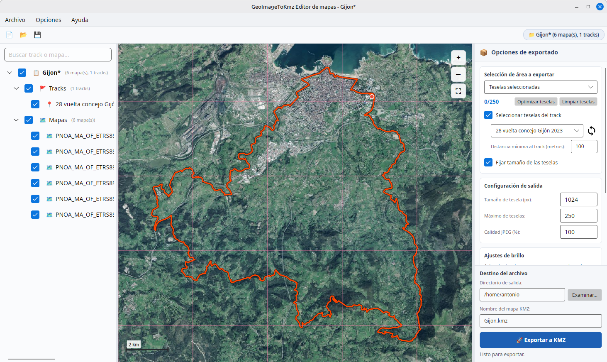
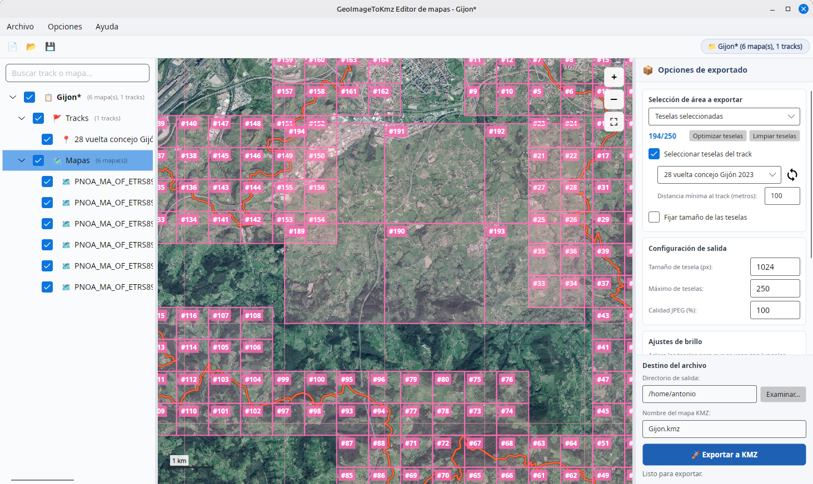
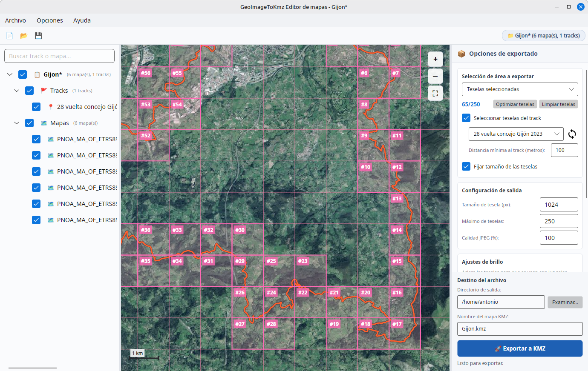

# GeoImageToKmz Map Editor

**Guides:** 🇪🇸 [Español](README.md) · 🇬🇧 [English](README.en.md) · 🇫🇷 [Français](README.fr.md) · 🇩🇪 [Deutsch](README.de.md)

Prepare maps, select an area, and create a KMZ for your viewer or compatible device.

## Contents

- [Getting started](#inicio)
- [Garmin Custom Maps](#garmincustommaps)
- [Interface and navigation](#interfaz)
- [Projects](#proyectos)
- [Maps and tracks](#mapas-tracks)
- [KMZ export](#exportacion)
- [Selecting tiles](#teselas)
- [Workflow with small tiles](#teselas-pequenas)
- [Workflow with large tiles](#teselas-grandes)
- [Selecting an area from a track](#track)
- [Output and brightness settings](#ajustes-salida)
- [Language and temporary directories](#directorios)
- [Map sources and about](#fuentes-mapas-acerca)
- [Troubleshooting](#problemas)
- [Development](#development)

<a id="inicio"></a>
## Getting started

1. Open the editor and load one or more georeferenced raster files supported by GDAL with **Load maps** or by dragging them into the window.
2. To use a route, load a GPX file with **Load tracks**. This helps you create a map around the track.
3. Check the visible layers, select an area and export settings, then choose the KMZ destination.
4. Click **Export to KMZ**, wait for confirmation, and check the result in your target viewer or device.

On Windows, start the application from its `.exe` file. On Linux, run `./GeoImageToKmzMapEditor`.



<a id="GarminCustomMaps"></a>
## Garmin Custom Maps

This application is well suited to creating Garmin Custom Maps in KMZ format. Manually creating them can be tedious because each device imposes its own restrictions. Check your device's limits and configure the options accordingly.

Garmin BaseCamp can help: if you try to copy a map with more tiles than allowed, it reports that the limit was exceeded. The application has been tested with a Garmin Edge 850, which has a 250-tile limit. Compatibility information and limits vary by device, so you may need to test yours.

Because tile size and count are limited, map quality and resolution depend on the number of tiles. More tiles can provide a larger or more detailed map: 250 tiles covering one square kilometre provide more detail than 100 tiles covering the same area. Try to use as many tiles as your device allows. You can select very small tiles along the route, then zoom out and add larger, lower-detail tiles around them for the surrounding area or possible escape routes.



<a id="interfaz"></a>
## Interface and navigation

The window brings together the project, map and track tree, the central viewer, and the **Export options** panel. The status bar shows information such as coordinates, loading progress, and errors.

Drag on the map to pan; use the wheel or the **+** and **−** buttons to zoom in or out, and **Fit full map** to return to the full extent. Displayed coordinates depend on the map projection.

<a id="proyectos"></a>
## Projects

From **File**, you can create, open, save, or save a project under a new name. Projects use the `.gtk` extension. Use the tree to rename or close items. If there are unsaved changes when you close, the editor asks whether to save them.

A project stores references to files and work options, including selected tiles. Keep the original raster and GPX files and their paths available: saving a project is not the same as exporting a KMZ.

<a id="mapas-tracks"></a>
## Maps and tracks

Use **Load maps** to select supported raster files such as `.tif`, `.tiff`, or `.jp2`, and **Load tracks** to select `.gpx` files. The tree lets you search, change visibility, and close items; its context menu includes actions such as opening the containing folder.

Visible raster layers are included in the export. Hide any layers you do not want, and check that the maps and track cover the same area. GPX is used to display the route and select an area; do not assume the track is exported as a separate line in the KMZ.

<a id="exportacion"></a>
## KMZ export

Under **Area to export**, choose one of the following:

- **Selected maps**: process the complete visible raster layers.
- **Selected tiles**: process the rectangular areas selected in the viewer.
- **Crop map to track contour**: use the rectangle around the track plus the specified margin; this is not a mask that follows the exact route.

In the export panel, enter the directory and file name; `.kmz` is added if needed. Click **Export to KMZ** and monitor overall and per-step progress. You can request **Cancel** during processing; wait for the cancellation message before continuing.

<a id="teselas"></a>
## Selecting tiles

Select **Selected tiles**. In navigation mode, click a map cell to add it; click inside a selected tile to remove it. Drag to pan. The counter shows selected/maximum; once the maximum is reached, no more tiles can be added manually.

The grid represents geographic extents: until a size is locked, zoom determines each cell's ground dimensions. **Lock tile size** reuses the geographic dimensions of the first selection for later selections, even when you change zoom. Turn it off to choose new dimensions at another zoom level; existing selections remain.

**Clear tiles** removes the entire selection. **Optimize tiles** subdivides selected areas uniformly, making use of the available maximum; it does not merge tiles or raise the maximum. If there is not enough room, it may make no changes. The geographic size of these selections is different from **Tile size (px)**, which controls output pixels.

<a id="teselas-pequenas"></a>
## Workflow with small tiles

1. Select tile mode, clear the selection if needed, and zoom in until cells cover small areas.
2. Select the desired cells. To keep their geographic size while navigating, enable **Lock tile size** after selecting the first tile.
3. Review coverage and the counter; raise the maximum if needed or reduce the area. Set the destination and output options, then export.

Small areas allow more precise selection but may require more tiles. Check the limits of the target device. With the same output pixel size, a tile covering less ground can preserve more detail, provided the source image has enough resolution. For example, first select small tiles along the track; then turn off the lock, zoom out, and add larger, lower-detail tiles around them to extend coverage.

<a id="teselas-grandes"></a>
## Workflow with large tiles

1. Clear the selection and zoom out before selecting so each cell covers a larger area. Lock the size after the first selection if you want to keep it while zooming.
2. Select the required areas and check that they cover the intended route or region. A large cell may include terrain you do not need.
3. To subdivide those areas without changing their coverage, click **Optimize tiles** and review the counter. Then configure the output and export.

To select a different size, clear the tiles or turn off the lock and change the zoom. Optimization creates more, smaller selections; it does not guarantee a particular count.

<a id="track"></a>
## Selecting an area from a track

Load a GPX file and choose **Crop map to track contour**, the track, and the **Minimum distance to track** in metres. The export uses the track's bounding rectangle expanded by that margin, so it may include areas far from the route.

Alternatively, in **Selected tiles**, enable **Select tiles along track**, choose the track and margin, then click **Select tiles**. Nearby cells are selected. This replaces the previous selection; review the map and counter. Once the maximum is reached, no more tiles are added, so part of the track may remain uncovered. Adjust zoom, margin, and maximum, then repeat the selection if you need different coverage.



<a id="ajustes-salida"></a>
## Output and brightness settings

- **Tile size (px)**: 256 to 4096; default 1024. For Garmin Custom Maps, 1024 × 1024 pixels is a common reference; larger images may lose resolution or may not be supported by some devices.
- **Maximum tiles**: 1 to 1000; default 250. It limits selection and is used when generating the KMZ. Garmin Custom Maps limits depend on the model: some support 100 tiles and others 500, including other installed maps. Check your device specifications; 250 does not guarantee compatibility.
- **JPEG quality (%)**: 1 to 100 in the main panel; higher values usually preserve more detail at the cost of file size.
- **Brighten images before creating the KMZ**: enables gamma, brightness, and contrast adjustments. Gamma and contrast range from 0.1 to 10; brightness ranges from 0 to 100%. Gamma above 1 brightens midtones; brightness lifts dark areas, and contrast increases the difference between light and dark areas.

Image processing can be slow and use substantial memory and disk space, even if the final result is only a few megabytes. Try a small area first and check readability and file size before processing a large area. Settings saved in the project may change the initial values.

<a id="directorios"></a>
## Language and temporary directories

Under **Options → Language**, choose Spanish, English, French, or German. Under **Options → Directories**, check the effective temporary path and space used. Enter or browse to a custom folder and click **Save**; **Reset to default** restores the application's temporary folder.

**Caution:** **Clear temporary directory** deletes files and folders from the current temporary directory. Use a dedicated folder, not one containing personal data, and do not clear it while processing is underway.

<a id="fuentes-mapas-acerca"></a>
## Map sources and about

Under **Help → Maps**, choose **Spain** to open the [National Geographic Information Centre download catalogue](https://centrodedescargas.cnig.es/CentroDescargas/catalogo), or **France** to open the [French IGN BD ORTHO dataset](https://cartes.gouv.fr/rechercher-une-donnee/dataset/IGNF_BD-ORTHO). The application has been tested with PNOA `.tif` files and IGNF `.jp2` files.

**Help → About** displays the creator credit, “Created by Antonio Muñiz Vega using AI,” and states that the application comes with no warranty and is used at the user's own risk and responsibility. The application is distributed under the GNU General Public License, version 3 (GPL-3.0). See the [official license text](https://www.gnu.org/licenses/gpl-3.0.html) and the [project repository on GitHub](https://github.com/munizvega/GeoImageToKmz). The application uses the GDAL geospatial library; visit its [official website](https://gdal.org).

<a id="problemas"></a>
## Troubleshooting

- **No visible layers:** load a supported raster file and enable its visibility.
- **No tiles or track selected:** select at least one cell, or load and select a GPX file for the chosen mode.
- **Part of the route is missing:** review coverage in the viewer and the counter; change zoom, margin, or maximum, then select again.
- **Loading or export fails:** check that the files exist and are georeferenced, verify permissions, output path, temporary disk space, and the error message. Use a temporary directory with enough free space.
- **The KMZ does not look as expected:** check visible layers, area, and coordinate reference system; test tile size, quality, and brightness in the target viewer or device.

<a id="development"></a>
## Development

This standalone .NET solution contains the processing library and interactive map editor; the original console application and `TifToKmzUI` are not included.

- `GeoImageToKmzLib`: geospatial image processing, GDAL utilities, geometry, and KMZ export services. The `TifToKmz` and `TifToKmzLib` namespaces are retained for source and API compatibility.
- `GeoImageToKmzMapEditor`: Avalonia desktop map editor and viewer, referencing `GeoImageToKmzLib`.

Both projects target .NET 10. Package versions and native GDAL dependencies remain the same as in the source projects. The configured GDAL runtime packages cover `linux-x64` and `win-x64` publishing.

From this directory, build and run:

```bash
dotnet build GeoImageToKmz.slnx -c Release
dotnet run --project GeoImageToKmzMapEditor/GeoImageToKmzMapEditor.csproj
```

Publish for the target operating system and architecture so the matching native GDAL runtime is included:

```bash
dotnet publish GeoImageToKmzMapEditor/GeoImageToKmzMapEditor.csproj -c Release -r linux-x64 --self-contained true -o artifacts/publish/linux-x64
dotnet publish GeoImageToKmzMapEditor/GeoImageToKmzMapEditor.csproj -c Release -r win-x64 --self-contained true -o artifacts/publish/win-x64
```