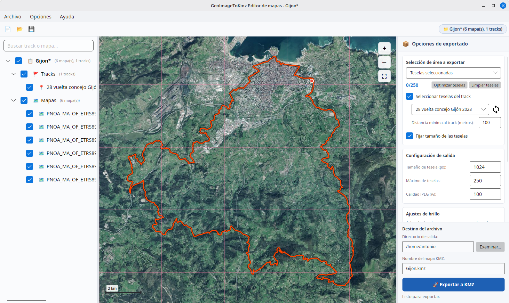
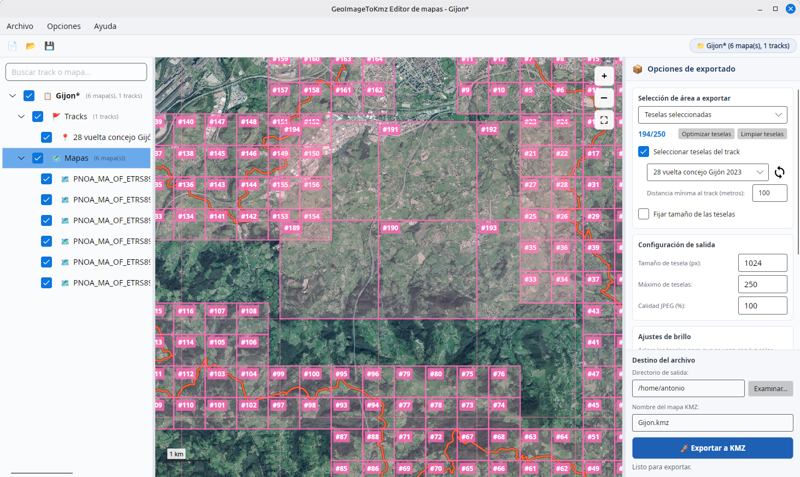
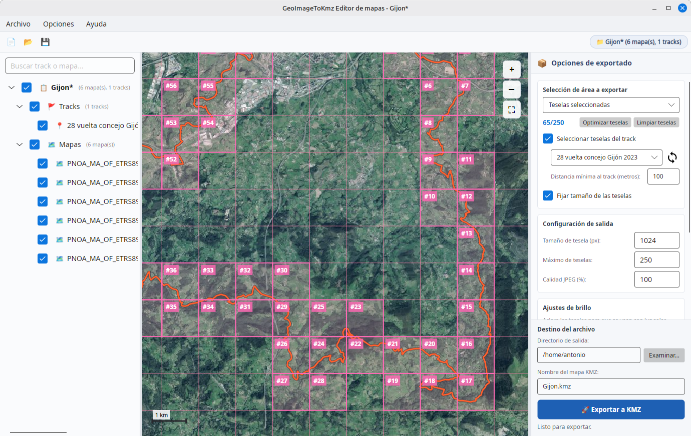

# GeoImageToKmz Map Editor

**Guías:** 🇪🇸 [Español](README.md) · 🇬🇧 [English](README.en.md) · 🇫🇷 [Français](README.fr.md) · 🇩🇪 [Deutsch](README.de.md)

Prepare mapas, seleccione una zona y genere un KMZ para su visor o dispositivo compatible.

## Descargas

- [Linux](https://github.com/munizvega/GeoImageToKmz/releases/download/v1.0.0/GeoImageToKmzMapEditorLinux.zip)
- [Windows](https://github.com/munizvega/GeoImageToKmz/releases/download/v1.0.0/GeoImageToKmzMapEditorWindows.zip)

## Contenido

- [Primeros pasos](#inicio)
- [Garmin Custom Maps](#garmincustommaps)
- [Interfaz y navegación](#interfaz)
- [Proyectos](#proyectos)
- [Mapas y tracks](#mapas-tracks)
- [Exportación a KMZ](#exportacion)
- [Selección de teselas](#teselas)
- [Flujo con teselas pequeñas](#teselas-pequenas)
- [Flujo con teselas grandes](#teselas-grandes)
- [Selección mediante track](#track)
- [Ajustes de salida y brillo](#ajustes-salida)
- [Idioma y directorios temporales](#directorios)
- [Fuentes de mapas y acerca de](#fuentes-mapas-acerca)
- [Resolución de problemas](#problemas)
- [Desarrollo](#desarrollo)

<a id="inicio"></a>
## Primeros pasos

1. Abra el editor y cargue uno o varios rásteres georreferenciados compatibles con GDAL mediante **Cargar mapas** o arrastrándolos a la ventana.
2. Si desea utilizar una ruta, cargue un archivo GPX con **Cargar tracks**. Esto le ayudará a crear un mapa alrededor del track.
3. Compruebe las capas visibles, seleccione el área y los ajustes de exportación, y elija el destino del KMZ.
4. Pulse **Exportar a KMZ**, espere la confirmación y compruebe el resultado en el visor o dispositivo de destino.

En Windows, inicie la aplicación desde su archivo `.exe`. En Linux, ejecute `./GeoImageToKmzMapEditor`.



<a id="GarminCustomMaps"></a>
## Garmin Custom Maps

Esta aplicación es ideal para generar mapas personalizados para Garmin en formato KMZ. Dadas las restricciones de cada dispositivo, crearlos manualmente puede resultar muy tedioso. Consulte las restricciones de su dispositivo y configure las opciones según corresponda.

Garmin BaseCamp puede ayudar: si intenta copiar un mapa con más teselas de las permitidas, indicará que se ha superado el límite. La aplicación se ha probado con un Garmin Edge 850, cuyo límite es de 250 teselas. La compatibilidad y los límites varían según el dispositivo; quizá deba comprobarlos en el suyo.

Como hay límites en el tamaño y número de teselas, la calidad y resolución dependen de cuántas utilice. Más teselas permiten cubrir un área mayor o con más detalle: 250 teselas para un kilómetro cuadrado ofrecen más detalle que 100 para la misma área. Intente usar el máximo permitido. Puede seleccionar teselas pequeñas a lo largo del track y, después, alejar el zoom y añadir teselas mayores, con menos detalle, para los alrededores o posibles rutas de escape.



<a id="interfaz"></a>
## Interfaz y navegación

La ventana reúne el árbol de proyectos, mapas y tracks, el visor central y el panel **Opciones de exportado**. La barra de estado muestra información como coordenadas, carga y errores.

Arrastre sobre el mapa para desplazarse; use la rueda o los botones **+** y **−** para acercar o alejar y **Ajustar mapa completo** para volver a la extensión completa. Las coordenadas mostradas dependen de la proyección del mapa.

<a id="proyectos"></a>
## Proyectos

En **Archivo** puede crear, abrir, guardar o guardar como un proyecto. Los proyectos utilizan la extensión `.gtk`. El árbol permite cambiar el nombre o cerrar elementos. Al cerrar con cambios pendientes, el editor pregunta si desea guardarlos.

El proyecto conserva referencias a los archivos y opciones de trabajo, incluidas las teselas seleccionadas. Guarde también los rásteres y GPX originales y mantenga sus rutas disponibles: guardar el proyecto no equivale a exportar un KMZ.

<a id="mapas-tracks"></a>
## Mapas y tracks

Use **Cargar mapas** para seleccionar archivos ráster compatibles, como `.tif`, `.tiff` o `.jp2`, y **Cargar tracks** para archivos `.gpx`. El árbol permite buscar, cambiar la visibilidad y cerrar elementos; su menú contextual ofrece acciones como abrir la carpeta contenedora.

Las capas ráster visibles son las entradas de la exportación. Oculte las que no desee incluir y compruebe que los mapas y el track cubran la misma zona. El GPX sirve para visualizar y seleccionar el área; no suponga que el track se exporta como una línea independiente en el KMZ.

<a id="exportacion"></a>
## Exportación a KMZ

En **Selección de área a exportar** elija:

- **Mapas seleccionados**: procesa las capas ráster visibles completas.
- **Teselas seleccionadas**: procesa las zonas rectangulares elegidas en el visor.
- **Reducir mapa al contorno del track**: usa el rectángulo que engloba el track más el margen indicado, no una máscara que siga exactamente la línea.

En el panel de exportación indique el directorio y el nombre del archivo; se añade `.kmz` si falta. Pulse **Exportar a KMZ** y observe el progreso total y por paso. Durante el proceso puede solicitar **Cancelar**; espere el mensaje de cancelación antes de continuar.

<a id="teselas"></a>
## Selección de teselas

Seleccione **Teselas seleccionadas** y, en modo navegación, haga clic en una celda del mapa para añadirla; haga clic dentro de una tesela seleccionada para quitarla. Arrastre para desplazarse. El contador indica seleccionadas/máximo; al alcanzar el máximo no se añaden más manualmente.

La cuadrícula representa extensiones geográficas: sin una selección fijada, el zoom determina su tamaño sobre el terreno. **Fijar tamaño de las teselas** reutiliza las dimensiones geográficas de la primera selección para las siguientes, incluso al cambiar el zoom. Desactívelo para elegir nuevas dimensiones con otro zoom; las selecciones anteriores permanecen.

**Limpiar teselas** elimina toda la selección. **Optimizar teselas** subdivide las seleccionadas de forma uniforme aprovechando el máximo disponible; no fusiona teselas ni aumenta el máximo. Si no hay margen suficiente, puede no cambiar nada. El tamaño geográfico de estas selecciones no es lo mismo que **Tamaño de tesela (px)**, que configura los píxeles de salida.

<a id="teselas-pequenas"></a>
## Flujo con teselas pequeñas

1. Seleccione el modo de teselas, limpie la selección si es necesario y acerque el mapa hasta obtener celdas que cubran áreas pequeñas.
2. Seleccione las celdas deseadas. Para mantener ese tamaño geográfico mientras navega, active **Fijar tamaño de las teselas** tras seleccionar la primera.
3. Revise la cobertura y el contador; aumente el máximo permitido si hace falta o reduzca el área. Configure destino y salida y exporte.

Las áreas pequeñas permiten una selección más precisa, pero pueden requerir más teselas. Compruebe los límites del dispositivo de destino. Con el mismo tamaño de salida en píxeles, una tesela que cubre menos terreno puede conservar más detalle, siempre que la imagen original tenga resolución suficiente. Por ejemplo, seleccione primero teselas pequeñas que toquen el track; después desactive la fijación, aleje el mapa y añada teselas mayores alrededor, con menor detalle, para ampliar la cobertura.

<a id="teselas-grandes"></a>
## Flujo con teselas grandes

1. Limpie la selección y aleje el mapa antes de seleccionar, para que cada celda abarque una zona mayor. Fije el tamaño tras la primera si quiere conservarlo al cambiar de zoom.
2. Seleccione las zonas necesarias y compruebe que cubren el recorrido o territorio previsto. Una celda grande puede incluir terreno que no necesita.
3. Si desea subdividir esas zonas sin cambiar su cobertura, pulse **Optimizar teselas** y revise el contador. Después ajuste la salida y exporte.

Para volver a seleccionar con otro tamaño, limpie las teselas o desactive la fijación y cambie el zoom. La optimización crea más selecciones pequeñas; no garantiza una cantidad concreta.

<a id="track"></a>
## Selección mediante track

Cargue un GPX y elija **Reducir mapa al contorno del track**, el track y la **Distancia mínima al track** en metros. Se exporta el rectángulo envolvente ampliado por ese margen, por lo que puede incluir áreas alejadas del recorrido.

Como alternativa, en **Teselas seleccionadas** active **Seleccionar teselas del track**, elija el track y el margen, y pulse **Seleccionar teselas**. Se seleccionan celdas próximas al recorrido. Esta acción reemplaza la selección anterior; revise el mapa y el contador: al llegar al máximo se deja de añadir teselas y puede quedar parte del track sin cubrir. Ajuste zoom, margen y máximo y repita la selección si necesita otra cobertura.



<a id="ajustes-salida"></a>
## Ajustes de salida y brillo

- **Tamaño de tesela (px)**: entre 256 y 4096; por defecto 1024. Para Garmin Custom Maps, 1024 × 1024 píxeles es una referencia habitual; imágenes mayores pueden perder resolución o no ser compatibles según el dispositivo.
- **Máximo de teselas**: entre 1 y 1000; por defecto 250. Limita la selección y se utiliza al generar el KMZ. Los límites de Garmin Custom Maps dependen del modelo: algunos admiten 100 teselas y otros 500, contando también otros mapas instalados. Consulte las especificaciones del dispositivo; 250 no garantiza la compatibilidad.
- **Calidad JPEG (%)**: entre 1 y 100 en el panel principal; valores mayores suelen conservar más detalle a costa de más espacio.
- **Aclarar las imágenes antes de generar el KMZ**: activa gamma, brillo y contraste. Gamma y contraste admiten 0,1–10; brillo, 0–100 %. Una gamma superior a 1 aclara los tonos medios; el brillo levanta las zonas oscuras y el contraste aumenta la diferencia entre claros y oscuros.

El tratamiento de imágenes puede ser lento y necesitar mucha memoria y espacio en disco, aunque el resultado final sean unos pocos megas. Pruebe una zona pequeña y revise legibilidad y tamaño antes de generar una zona extensa. Los ajustes guardados en el proyecto pueden cambiar los valores iniciales.

<a id="directorios"></a>
## Idioma y directorios temporales

En **Opciones → Idioma** seleccione español, inglés, francés o alemán. En **Opciones → Directorios** consulte la ruta temporal efectiva y el espacio ocupado. Escriba o examine una carpeta personalizada y pulse **Guardar**; **Restablecer predeterminado** vuelve a la carpeta temporal de la aplicación.

**Precaución:** **Vaciar directorio temporal** elimina archivos y carpetas del directorio temporal actual. Utilice una carpeta dedicada, no una que contenga datos personales, y no la vacíe durante un procesamiento.

<a id="fuentes-mapas-acerca"></a>
## Fuentes de mapas y acerca de

En **Ayuda → Mapas** encontrará **España**, que abre el [catálogo del Centro Nacional de Información Geográfica](https://centrodedescargas.cnig.es/CentroDescargas/catalogo), y **Francia**, que abre el [conjunto de datos BD ORTHO del IGN francés](https://cartes.gouv.fr/rechercher-une-donnee/dataset/IGNF_BD-ORTHO). La aplicación se ha probado con ficheros `.tif` del PNOA y con ficheros `.jp2` de IGNF.

**Ayuda → Acerca de** muestra la autoría «Creada por Antonio Muñiz Vega utilizando IA» e informa de que la aplicación no ofrece ninguna garantía y de que su uso es responsabilidad y riesgo del usuario. La aplicación se distribuye bajo la Licencia Pública General de GNU, versión 3 (GPL-3.0). Puede consultar el [texto oficial de la licencia](https://www.gnu.org/licenses/gpl-3.0.html) y el [repositorio del proyecto en GitHub](https://github.com/munizvega/GeoImageToKmz). La aplicación utiliza la librería geoespacial GDAL; consulte su [sitio web oficial](https://gdal.org).

<a id="problemas"></a>
## Resolución de problemas

- **No hay capas visibles:** cargue un archivo ráster compatible y active su visibilidad.
- **No hay teselas o track seleccionado:** seleccione al menos una celda, o cargue y elija un GPX según el modo.
- **Falta parte del recorrido:** revise la cobertura en el visor y el contador; cambie el zoom, el margen o el máximo y vuelva a seleccionar.
- **No se puede cargar o exportar:** compruebe que existan los archivos, su georreferencia, los permisos, la ruta de salida, el espacio temporal y el mensaje de error. Use un directorio temporal con espacio suficiente.
- **El KMZ no se ve como esperaba:** compruebe las capas visibles, el área y el sistema de referencia; pruebe tamaño, calidad y brillo con el visor o dispositivo final.

<a id="desarrollo"></a>
## Desarrollo

Esta solución .NET independiente contiene la biblioteca de procesamiento y el editor de mapas interactivo; no incluye la aplicación de consola original ni `TifToKmzUI`.

- `GeoImageToKmzLib`: procesamiento de imágenes geoespaciales, utilidades GDAL, geometría y servicios de exportación KMZ. Se conservan los espacios de nombres `TifToKmz` y `TifToKmzLib` por compatibilidad de código fuente y API.
- `GeoImageToKmzMapEditor`: editor y visor de mapas de escritorio Avalonia, con referencia a `GeoImageToKmzLib`.

Ambos proyectos usan .NET 10. Se mantienen las versiones de paquetes y dependencias nativas GDAL de los proyectos fuente. Los paquetes de ejecución GDAL configurados cubren `linux-x64` y `win-x64`.

Desde este directorio, compile y ejecute:

```bash
dotnet build GeoImageToKmz.slnx -c Release
dotnet run --project GeoImageToKmzMapEditor/GeoImageToKmzMapEditor.csproj
```

Publique para el sistema operativo y la arquitectura de destino para incluir el runtime nativo GDAL correspondiente:

```bash
dotnet publish GeoImageToKmzMapEditor/GeoImageToKmzMapEditor.csproj -c Release -r linux-x64 --self-contained true -o artifacts/publish/linux-x64
dotnet publish GeoImageToKmzMapEditor/GeoImageToKmzMapEditor.csproj -c Release -r win-x64 --self-contained true -o artifacts/publish/win-x64
```